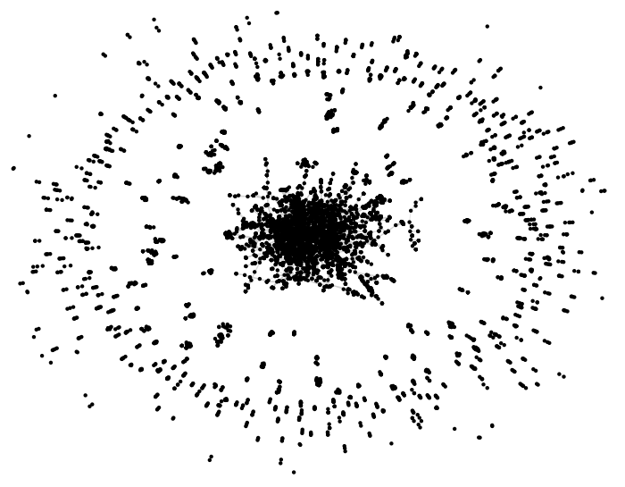
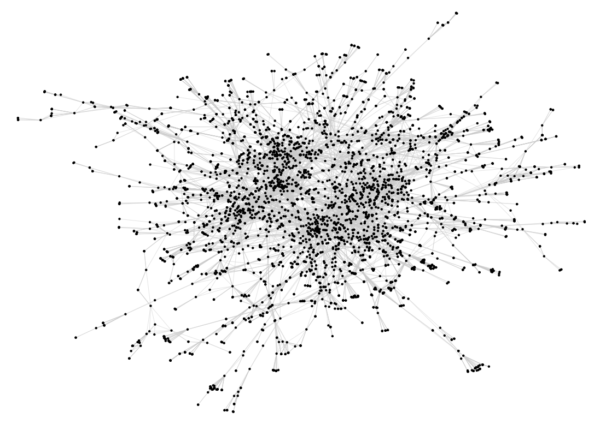
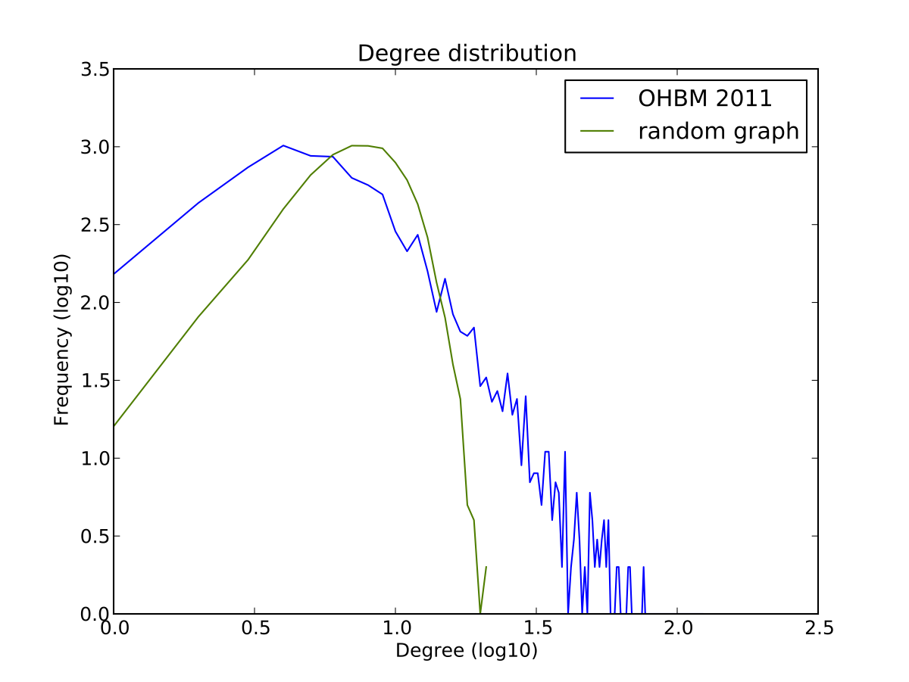
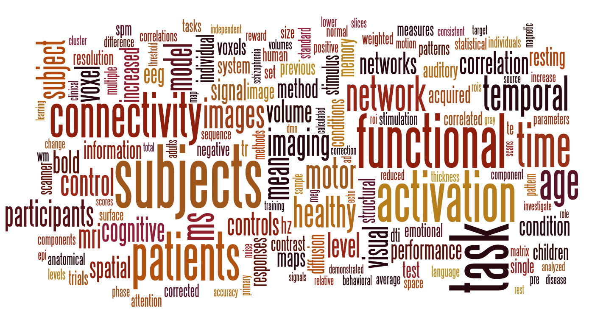
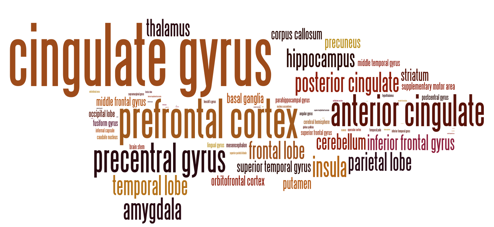
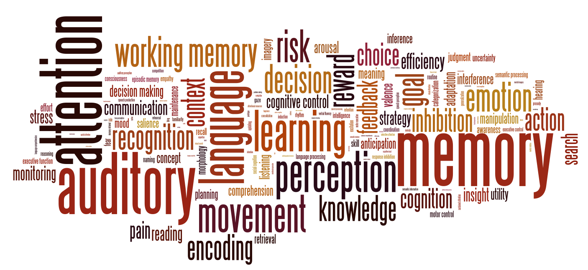

*This was originally posted on Blogger [here](https://russpoldrack.blogspot.com/2011/07/my-analysis-of-ohbm-2011-abstracts.html).*

As the past chair of the [Organization for Human Brain Mapping](http://www.humanbrainmapping.org/i4a/pages/index.cfm?pageid=1) (which just ended its [2011 meeting](http://www.humanbrainmapping.org/i4a/pages/index.cfm?pageID=3419) in Quebec City), I was tasked with giving the "Meeting Highlights" talk which traditionally closes the meeting. It's a pretty daunting challenge to summarize an entire meeting with such little time for preparation, so I took the tack of doing lots of mining on the full text of the abstracts prior to the meeting. My entire wrap-up talk is available [here](http://euphoria.clm.utexas.edu/shared/Poldrack_OHBMWrapup_June2011.pdf); below I present the main results of my text mining, along with some additional analyses that didn't make it into the talk.

**Overall meeting stats:**

  ----------------------------- ---------------
  Number of Abstracts           2230
  Number of Unique Authors      7622
  Mean \# of abstracts/author   1.64 (max=33)
  Mean \# of authors/abstract   5.6 (max=41)
  ----------------------------- ---------------

**Authorship distribution:**

The OHBM is known for being an international organization, and the authorship data confirm this. In order to visualize the authorship data, I used the Google Maps API to identify the latitude/longitude for each affiliation in the authorship list. This was successful for more than 90% of the abstracts. These latitude/longitude values were uploaded into Google Fusion Tables, from which I exported a KML file ([available here](https://github.com/poldrack/ohbm2011/blob/master/latlng.kml?raw=true)) which I then opened in Google Earth. (That's a lot of Google!)

Using Google Earth I then created a tour that circled the globe, showing all of the author locations on a path from Quebec City to Beijing (location of the 2012 meeting). Here is the video:



Each red pin represents the location of an author at the meeting.

**Authorship networks:**

Using the abstracts I created a coauthorship network and did some basic analyses on this network (using the [Networkx toolbox](http://networkx.lanl.gov/) in Python and the [Network Workbench](http://nwb.cns.iu.edu/)). The code and an anonymized version of the graph (in graphml format) are available [via github](https://github.com/poldrack/ohbm2011). Here is an overall view of the network:

This shows one giant connected component with 4600 authors (60.3%), along with a large number of much smaller components (the second largest component had 103 authors). Focusing in on the giant component, here is the spring-embedded visualization:

Here are the network statistics:

  ----------------------------------------------------- ------
  Clustering coefficient                                0.88
  Average degree                                        8.10
  Average shortest path length (giant component only)   6.96
  Maximum shortest path length                          18
  Modularity (giant component only)                     0.92
  ----------------------------------------------------- ------

Here is the degree distribution plotted in log space, with a degree distribution for a matched random graph for comparison:

The degree distribution has a long tail compared to the random network, which is what one would expect from this kind of network (for background on this kind of analysis, see Mark Newman's paper [The structure of scientific collaboration networks](http://arxiv.org/abs/cond-mat/0007214/)).

Using [PageRank centrality](http://en.wikipedia.org/wiki/PageRank), I identified the 10 most central authors in this network (listed with number of abstracts and centrality value):

1.  Paul Thompson (33 abstracts: 0.002020)
2.  Vince Calhoun (21 abstracts: 0.001816)
3.  Arno Villringer (23 abstracts: 0.001756)
4.  Arthur Toga (30 abstracts: 0.001625)
5.  Yong He (19 abstracts: 0.001416)
6.  Peter Fox (26 abstracts: 0.001381)
7.  Michael Milham (24 abstracts: 0.001340)
8.  Alan Evans (16 abstracts: 0.001318)
9.  Robert Turner (23 abstracts: 0.001292)
10. Daniel Margulies (13 abstracts: 0.001194)

**Content analysis:**\
**\**
\
Using the full text from the articles, I created several tag clouds (using [Wordle](http://www.wordle.net/)) to show different aspects of the content. The first was created from the entire abstract text after filtering out standard stop words along with anatomical regions and author names.

The second was created using a count of all anatomical terms (from the PubBrain anatomical lexicon):

The third was created using a count of all of the terms in the [Cognitive Atlas](http://www.cognitiveatlas.org/) lexicon of mental concepts:

These tag clouds give a good overview of the major topics at the meeting.\
**\**
\
**If you have other ideas for mining of these data, let me know and I'll give it a try. I have also done topic modeling using latent Dirichlet allocation, and may get around to writing about that in the future.**

---

## 1 comment captured from the [original post](https://russpoldrack.blogspot.com/2011/07/my-analysis-of-ohbm-2011-abstracts.html)

**Anonymous** · 2011-07-05

> Thanks for sharing this! I like the way you mix network analysis and infographics!\
> Very good idea to close a conference with this analysis. I hope that more neuroscientists will adopt your creative way to present data in the future.\
> I believe you're on the right track!
