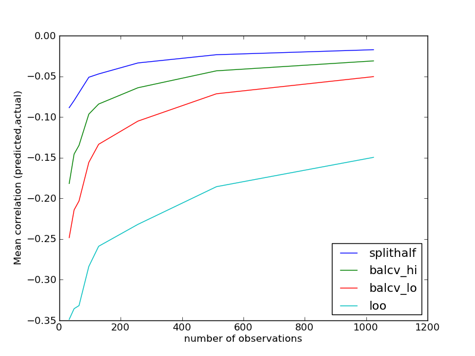

*This was originally posted on Blogger [here](https://russpoldrack.blogspot.com/2012/12/the-perils-of-leave-one-out.html).*

There is a common tendency of researchers in the neuroimaging field to use the term "prediction" to describe observed correlations. This is problematic because the strength of a correlation does not necessarily imply that one can accurately predict the outcome of new (out-of-sample) observations. Even if the underlying distributions are normally distributed, the observed correlation will generally overestimate the accuracy of predictions on out-of-sample observations due to overfitting (i.e., fitting the noise in addition to the signal). In degenerate cases (e.g., when the observed correlation is driven by a single outlier), it is possible to observe a very strong in-sample correlation with almost zero predictive accuracy for out-of-sample observations.

The concept of crossvalidation provides a way out of this mess; by fitting the model to subsets of the data and examining predictive accuracy on the held-out samples, it's possible to directly assess the predictive accuracy of a particular statistical model. This approach has become increasingly popular in the neuroimaging literature, which should be a welcome development. However, crossvalidation in the context of regression analyses turns out to be very tricky, and some of the methods that are being used in the literature appear to be problematic.

One of the most common forms of crossvalidation is "leave-one-out" (LOO) in which the model is repeatedly refit leaving out a single observation and then used to derive a prediction for the left-out observation. Within the machine learning literature, it is widely appreciated that LOO is a suboptimal method for cross-validation, as it gives estimates of the prediction error that are more variable than other forms of crossvalidation such as K-fold (in which the training/testing is performed after breaking the data into K groups, usually 5 to 10) or bootstrap; see Chapter 7 in [Hastie et al.](http://www-stat.stanford.edu/~tibs/ElemStatLearn/) for a thorough discussion of this issue).

There is another problem with LOO that is specific to its use in regression. We discovered this several years ago when we started trying to predict quantitative variables (such as individual learning rates) from fMRI data. One thing that we always do when running any predictive analysis is to perform a randomization test to determine the distribution of performance when the relation between the data and the outcome is broken (e.g., by randomly shuffling the outcomes). In a regression analysis, what one expects to see in this randomized-label case is a zero correlation between the predicted and actual values. However, what we actually saw was a very substantial negative bias in the correlation between predicted and actual values. After lots of head-scratching this began to make sense as an effect of overfitting. Imagine that you have a two-dimensional dataset where there is no true relation between X and Y, and you first fit a regression line to all of the data; the slope of this line should on average be zero, but will likely deviate from zero on each sample due to noise in the data (an effect that is bigger for smaller sample sizes). Then, you drop out one of the datapoints and fit the line again; let's say you drop out one of the observations at the extreme end of the X range. On average, this is going to have the effect of bringing the estimated regression line closer to zero than the full estimate (unless your left-out point was right at the mean of the Y distribution). If you do this for all points, you can then see how this would result in a negative correlation between predicted and actual values when the true slope is zero, since this procedure will tend to pull the line towards zero for the extreme points.

To see an example of this fleshed out in an ipython notebook, visit <http://nbviewer.ipython.org/4221361/> - the full code is also available at <https://github.com/poldrack/regressioncv>. This code creates random X and Y values and then tests several different crossvalidation schemes to examine their effects on the resulting correlations between predicted and true values. I ran this for a number of different samples sizes, and the results are shown in the figure below (NB: figure legend colors fixed from original post).

The best (i.e. least biased) performance is shown by the split half method. Note that this is a special instance of split half crossvalidation with perfectly matched X distributions, because it has exactly the same values on the X variable for both halves. The worst performance is seen for leave-one-out, which is highly biased for small N's but shows substantial bias even for very large N's. Intermediate performance is seen when a balanced 8-fold crossvalidation scheme is used; the "hi" and "lo" versions of this are for two different balancing thresholds, where "hi" ensures fairly close matching of both X and Y distributions across folds whereas "lo" does not. We have previously used balanced crossvalidation schemes on real fMRI data ([Cohen et al., 2010](http://www.frontiersin.org/human_neuroscience/10.3389/fnhum.2010.00047/abstract)) and found them to do a fairly good job of removing bias in the null distributions, but it's clear from these simulations that bias can still remain.

As an example using real data, I took the data from a paper entitled ["Individual differences in nucleus accumbens activity to food and sexual images predict weight gain and sexual behavior" by Demos et al](http://www.ncbi.nlm.nih.gov/pubmed/22514316). The title makes a strong predictive claim, but what the paper actually found was an observed correlation of r=0.37 between neural response and future weight gain. I ripped the data points from their scatterplot using [PlotDigitizer](http://plotdigitizer.sourceforge.net/) and performed a crossvalidation analysis using leave-one-out and 4-fold crossvalidation either with or without balancing of the X and Y distributions across folds (see code and data in the [github repo)](https://github.com/poldrack/regressioncv). The table below shows the predictive correlations obtained using each of the measures (the empirical null was obtained by resampling the data 500 times with random labels; the 95th percentile of this distribution is used as the significance cutoff):

  ----------------- ---------------- ----------------------------------- ----------
  CV method         r(pred,actual)   r(pred,actual) with random labels   95%ile
  LOO               0.176395         -0.276977                           0.154975
  4-fold            0.183655         -0.148019                           0.160695
  Balanced 4-fold   0.194456         -0.066261                           0.212925
  ----------------- ---------------- ----------------------------------- ----------

This analysis shows that, rather than the 14% of variance implied by the observed correlation, one can at best predict about 4% of the variance in weight gain from brain activity; this result is not significant by a resampling test, though the LOO and 4-fold results, while weaker numerically, are significant compared to their respective empirical null distributions. (Note that a small amount of noise was likely introduced by the data-grabbing method, so the results with the real data might be a bit better.)

UPDATE: As noted in the comments, the negative bias can be largely overcome by fixing the intercept to zero in the linear regression used for prediction. Here are the results obtained using the zero-intercept model on the Demos et al. data:

  ----------------- ---------------- ----------------------------------- --------
  CV method         r(pred,actual)   r(pred,actual) with random labels   95%ile
  LOO               0.258            -0.067                              0.189
  4-fold            0.263            -0.055                              0.192
  Balanced 4-fold   0.256            -0.037                              0.213
  ----------------- ---------------- ----------------------------------- --------

This gets us up to about 7% variance accounted for by the predicted model, or about half of that implied by the in-sample correlation, and now the correlation is significant by all CV methods.

Take-home messages:

- Observed correlation is generally larger than predictive accuracy for out-of-sample observations, such that one should not use the term "predict" in the context of correlations.
- Cross-validation for predicting individual differences in fMRI analysis is tricky.
- Leave-one-out should probably be avoided in favor of balanced k-fold schemes
- One should always run simulations of any classifier analysis stream using randomized labels in order to assess the potential bias of the classifier. This means running the entire data processing stream on each random draw, since bias can occur at various points in the stream.

PS: One point raised in discussing this result with some statisticians is that it may reflect the fact that correlation is not the best measure of the match between predicted and actual outcomes. If someone has a chance to take my code and play with some alternative measures, please post the results to the comments section here, as I don't have time to try it out right now.

PPS: I would be very interested to see how this extends to high-dimensional data like those generally used in fMRI. I know that the bias effect occurs in that context given that this is how we discovered it, but I have not had a chance to simulate its effects.

---

## 13 comments captured from the [original post](https://russpoldrack.blogspot.com/2012/12/the-perils-of-leave-one-out.html)

**Russ Poldrack** · 2012-12-17

> Agreed, there are many different senses of the term "predict". My main point here is that correlation (even if one variable precedes the other in time) does not imply predictive accuracy in a statistical sense. I think a lot of people in our field don't appreciate the "out-of-sample" problem (discussed very nicely, BTW, in Nate Silver's book)

**Brian Knutson** · 2012-12-17

> I think they were using "prediction" in the temporal sense...\
> (i.e., the sampling occurred before the behavior). It would\
> be great though to explicitly specify what one means by "prediction"\
> (for instance, within or out of sample).

**Russ Poldrack** · 2012-12-17

> Thanks Yarick - nbviewer seems a bit flaky. I've added the ipynb file to the git repo.

**yarikoptic** · 2012-12-17

> nbviewer link seems to be 404\
> why not to add the .ipynb into the git repository?

**Kevin Mitchell** · 2012-12-17

> Really interesting post, which I think goes beyond problems with leave-one out cross-validation and highlights the general pitfalls of relying exclusively on statistical methods to infer predictive power from a set of exploratory data. What is needed is replication with an independent sample. (As geneticists have been requiring for quite a while now).

**Russ Poldrack** · 2012-12-18

> Thanks Yarick - what do you think the takeaway is? Perhaps that correlation is a the wrong measure to use for assessing predictive accuracy of regression analyses?

**yarikoptic** · 2012-12-18

> ok -- played with it more and now negative bias (when you fit with\
> fitting intercept) makes perfect sense to me if you compute\
> correlation between full original time series and target one,\
> predicted in cross-validated fashion.
>
> Reason is actually quite simple: in every cross-validation fold, by\
> taking "testing" set out, mean of the training data changes from the\
> 'grand mean' in the opposite direction to the mean of the taken out\
> (for testing) data \[e.g. for split-half, grand mean was = 0, mean of\
> testing data 0.1, mean of training data becomes -0.1\]
>
> By training you are fitting the line to the training data, which is\
> "offset" from the grand mean so it is likely to obtain a line offset\
> in the same direction \[in our example it is likely to be a line BELOW\
> "grand" line, and having negative intercept\]. And per "construction"\
> it would be in the opposite direction from the grand mean than the\
> left-out testing samples.
>
> For another split of the data, you are likely to get offset in the\
> opposite direction \[.e.g in our example it would be testing gets -0.1,\
> while training 0.1\], and result would be as before -- predicted data\
> has an opposing offset from grand mean than testing data.
>
> Therefore if you are computing correlation later on the whole series\
> of predicted/original values (not like I suggested -- mean of\
> estimates in each split) -- you are likely to obtain negative\
> correlation due to the tendency of predicted data being in opposite\
> direction from the original one merely due to difference in the means.
>
> Without intercept linear model looses this "flexibility" of choosing\
> "the other side", so it becomes less prominent (but imho it is still\
> present one way (mean) or another (variance)).
>
> Really crude example is here (disregard initial scatter plots --\
> absent shuffle for cross-validation somehow plays an interesting\
> role. and I had to disable shuffling for my example below)
>
> http://nbviewer.ipython.org/url/www.onerussian.com/tmp/regression_cv_demos_normal_noisy100_nofit_intercept.ipynb
>
> It is left to figure out on the strong bimodal distribution of the\
> means. They are somewhat surprising to me since I haven't observed\
> them before when in a searchlight using cross-validation on\
> correlations \[e.g. figure 5 in\
> http://onerussian.com/tmp/transfusion-20120411.pdf , disregard the\
> footnotes -- it wasn't submitted\]. But probably that was because data\
> was not actually random and did have a strong positive bias ;)

**Russ Poldrack** · 2012-12-20

> Niko - thanks for your comments. The exploration issue is completely separate from what I am talking about here - in fact this problem initially arose for us in the context of whole-brain analyses where we were trying to predict some behavioral measure from whole-brain activation. Some further explorations (based on suggestions by Sanmi Koyejo, mentioned in Yarick's comment and implemented I think in the latest code on the repo, but not really discussed explicitly) show that the problem is due to the intercept term in the linear regression. I was not suggesting that the correlation estimates are biased across separate samples from a population; rather, I was highlighting the negative dependency that you mention, which is seen in a bias in the correlation between predicted and actual outcomes across folds.
>
> I'm not sure that "crossvalidated correlation" is the right term for what I computed. I basically perform a linear regression on the training set and then use that regression solution to predict the values of the test set. I then compute the correlation between the predicted and actual values - it's this correlation that I find to be biased, but whose bias appears to largely go away when the intercept is fixed to zero in the regression. You may be right that a Bayesian approach is a better way to address this - if only I had time to give it a try!

**Anonymous** · 2012-12-20

> this is thought-provoking. but i’m not sure i understand why the sample correlation is misleading in the absence of any exploration.
>
> crossvalidation serves to estimate out-of-sample performance of a predictive model. crossvalidation is needed to account for the exploration process, e.g. when searching for a predictive variable (such as a brain location) or fitting parameters.
>
> i've seen the bias of leave-one-out crossvalidation in this context. the cross-subject correlation of brain activity with some subject covariate will obviously be highly biased when selecting the peaks of a brain map. the selection is the exploration (or ROI fitting) process and we need some form of crossvalidation. consistent with the discussion here, leaving one subject out is not a good way of getting an estimate of the out of sample correlation.
>
> i'm also familiar with the negative accuracy bias incurred by leaving one data point out in classification -- which can be understood as reflecting the fact that the frequencies of different classes are slightly biased against the left-out point, because that point is missing.
>
> if you split a set of numbers into two halves, one half is likely to be higher and the other lower than the average. similarly, if you split a set of points from an isotropic bivariate gaussian (i.e. no correlation), one half is likely to have a higher sample correlation than the correlation for the entire sample and the other half a lower one. so splitting creates a negative dependency between the samples.
>
> however, i'm puzzled by this post, because you seem to be suggesting that even without any exploration or fitting, the sample correlation is a biased estimate of the correlation expected for another sample of the same size from the same population.
>
> correlation can be understood as fitting a line. if the line fitted to the sample were used to predict out of sample, it would do worse in terms of the sum of squared errors. however, if we construe correlation simply as a measure of association, and use the correlation in one sample as an estimate of the correlation in another sample of the same size, it should be a good estimate.
>
> imagine i take two samples from a population, measure two variables (height and weight, say). now i choose one of the samples at random, give it to you and ask you to give me your best estimate of the correlation in the other sample. what should you do?
>
> the samples are exchangeable, so the correlation in your sample is not expected to be either higher or lower than the correlation in the other sample. this justifies its use as an estimate in my mind.
>
> am i missing something?
>
> of course, even under the null hypothesis of no correlation we will see deviations from 0 in the sample correlation. so the absolute value of any sample correlation is necessarily biased. a bayesian analysis aiming to estimate the expected or the maximum a posteriori population correlation will lead you to shrink toward zero. perhaps the methods you suggest serve a similar purpose? but i don't understand the full motivation for the crossvalidation approach here – e.g. as opposed to the bayesian approach. (i also don’t understand exactly how you compute the crossvalidated correlation. i couldn't see this quickly in the code link, perhaps you can explain briefly?)
>
> from a quick look, the cited paper seemed to use a prior hypothesis about the brain region and an anatomical ROI. so if we assume there was no exploration at all, then i don’t see what’s wrong here.
>
> i do expect the correlation estimate to decline in replications. but only because of the file drawer problem, i.e. similar attempts may have been made before, but when they didn’t yield significant results they were forgotten about – that is, because of the exploration process at the level of the whole field followed by selective publication.
>
> Niko Kriegeskorte

**Aaron Schurger** · 2013-01-12

> Hi, Russ,\
> I've also run into a similar issue with the LOO procedure, after I was alerted to the potential bias by Lucas Parra. In our case we are using LOO with matched filtering (essentially Fisher's linear discriminant, but without taking the noise covariance into account). We are \*not\* doing classification (as in LDA), but just projecting onto the (normalized) discriminant vector and then looking at the continuous valued result. In this case the mean is unbiased (as best I can tell after lots of testing), but the distribution is skewed to the left, so the median is always \> 0. As a result a sign test or signed rank test is highly significant even for gaussian random data. This is especially pronounced when there are very few dimensions (like \< 10), but for about 20 - 100 dimensions the skew becomes negligible (things might be different when you have even more dimensions - I haven't tried). In any event, because the mean seems to remain unbiased (in this case at least - not for correlation as you've found), then analyses across subjects should be OK. Within subject, you would want to do a resampling test (which I guess you should always do anyway). Again, thanks to Lucas Parra for pointing this out to us.

**Russ Poldrack** · 2013-07-27

> Trevor - many thanks for digging into this!

**not2Hastie** · 2013-07-27

> My student Will Fithian and I have responded to this interesting phenomenon. Since I could not figure out how to use Mathjax in blogger, I ended up entering the material in tumblr. Here is the url: http://not2hastie.tumblr.com/
>
> Sorry for the inconvenience, but please have a look
>
> Trevor Hastie\
> Stanford Statistics

**Anonymous** · 2017-04-20

> This is an interesting post! I observed this as well, and puzzled over it, when doing analyses for our 2011 J Neuro paper predicting placebo responses. I arrived at the conclusion that the correlation metric is not a good outcome metric for optimizing models, for two reasons.\
> - Assessing the correlation involves fitting another model on the cross-validated predictive estimates, with one slope parameter and two variance parameters\
> - The null hypothesis is not exactly zero, for reasons you and other commentators have raised. (Yes, I think ithe same fundamental principle applies to cases with unbalanced LOO cross-validation with two groups and LOO with regression, as Niko pointed out).
>
> For that reason, we optimized the models minimizing absolute prediction error, and reported error. We've been using permutation tests to check/validate what the null distribution is, and for prediction error (not correlation) these are zero with a valid LOO cross-validation on independent observations. But correlations are intuitive and people generally understand what the values mean (though point taken that they can be somewhat misleading if the null is not zero!), so we reported those as well and continue to do so for ease of communication when we feel that it's an adequate representation of prediction performance.
>
> A few other reflections and beliefs, appreciated after reading the Hastie book and some other literature:\
> - All cross-validated estimates are biased towards zero relative to the performance of the full sample, because you're excluding data points\
> - Among cross-val strategies, LOO is minimum bias but max variance, because the training samples are so similar (there is dependency among training samples across folds). The "minimum bias" here is independent of any bias induced by estimating correlations post hoc on cross-validated estimates, which does indeed induce a bias from a different source.\
> - k-fold with fewer folds biases accuracy estimates more strongly towards zero, but reduces variance. So there is a bias-variance tradeoff.\
> - The optimal cross-validation holdout set depends on sample size, and probably other things. With larger samples, you can get away with fewer folds without damaging model development (and thus performance) as much.\
> - Correlations are unbiased if only a single measure is tested, without any fishing.\
> - I generally like the idea of 5-fold or so, but for small samples, LOO seems OK to me, with appropriate checks and caveats -- i.e., observations must be truly independent, permutation test-based checks of the null distribution, and more. These days I figure that unless one tests peformance prospectively in truly independent datasets, trust in how well the model performs is limited anyway. So we've been trying to focus more on that.
