*This was originally posted on Blogger [here](https://russpoldrack.blogspot.com/2012/04/things-i-like-to-do-in-beijing.html).*

Several friends have asked for suggestions about things to do while in Beijing for the OHBM meeting this June. I don't have any particular wisdom, but having visited several times I thought that I would share a few of my favorite things (along with photos from some of our past trips). I'm not including many of the obvious attractions (Forbidden City, Summer Palace, Olympic Park) because I figure those will be in every guide book.

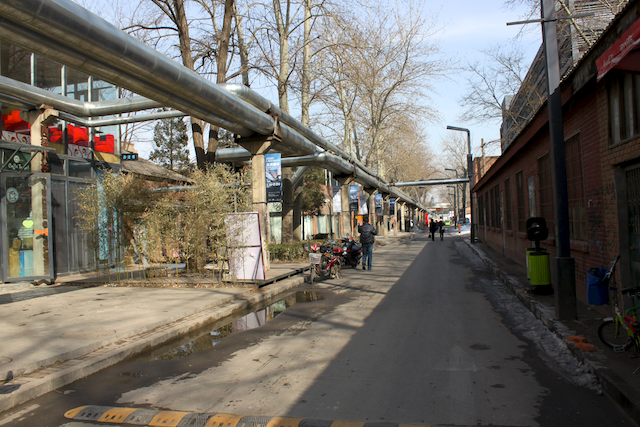

[798 Art Complex](http://www.798space.com/subpage_en.asp?classid=17): an amazing art complex created from an old factory complex. If you like modern art you can easily spend more than 1/2 a day there. There is a great noodle shop tucked away in the middle of the complex, and also at least one really nice cafe.

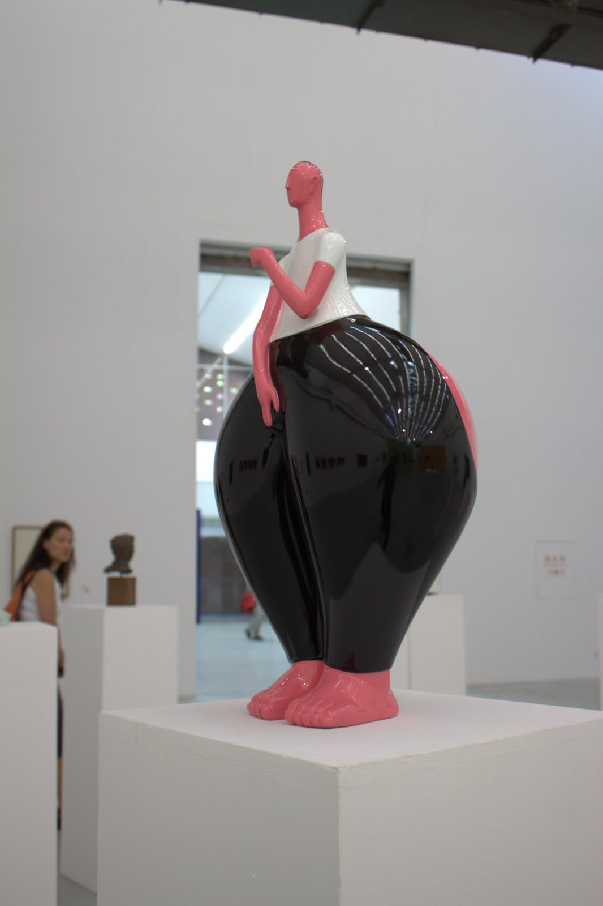\
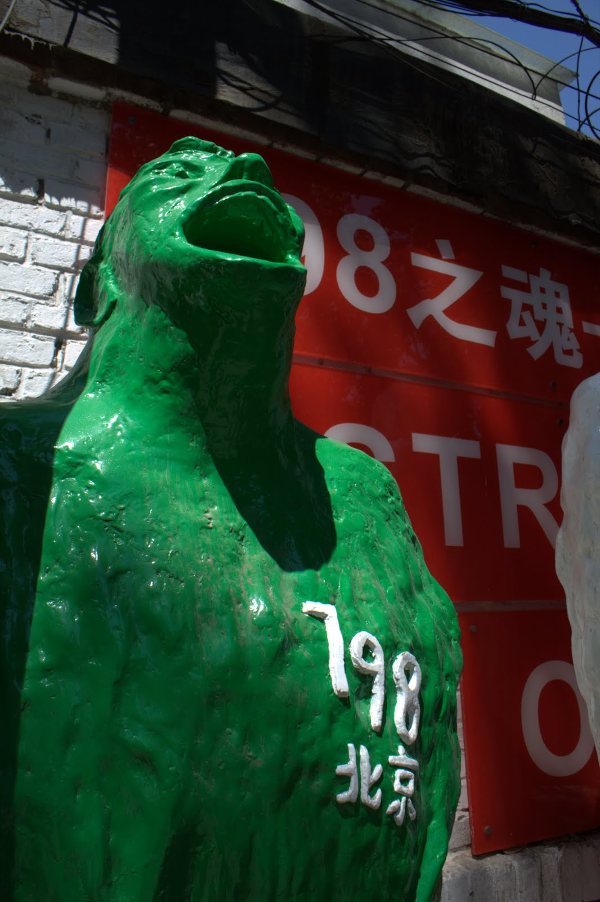\
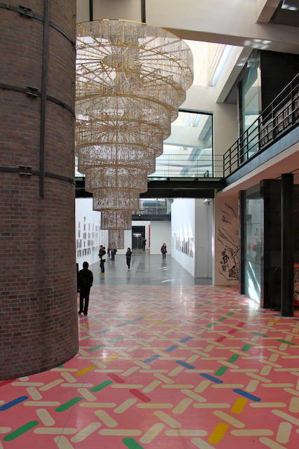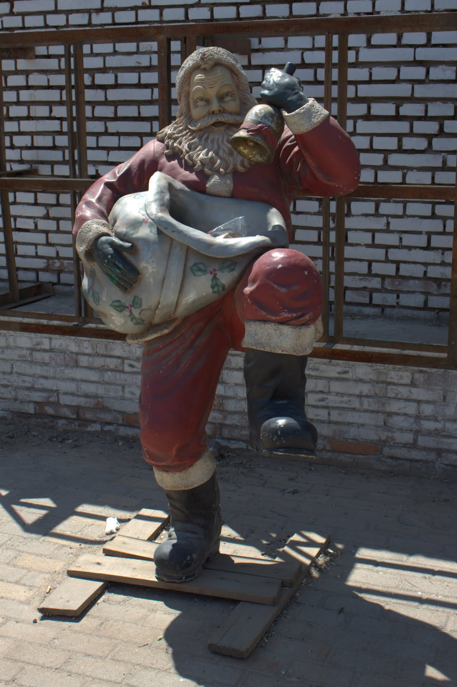

*Hutongs*: These are the old neighborhoods in the center of the city. Some of them are very touristy, but if you walk a few blocks off the main street you can find some streets that feel pretty far from touristy. I would particularly recommend the area around Heizhima Hutong, where these photos were taken.

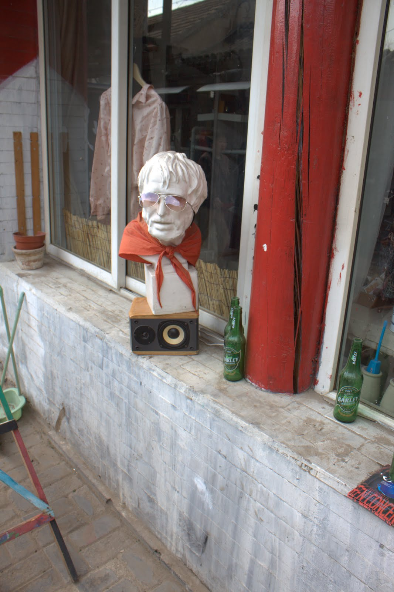\
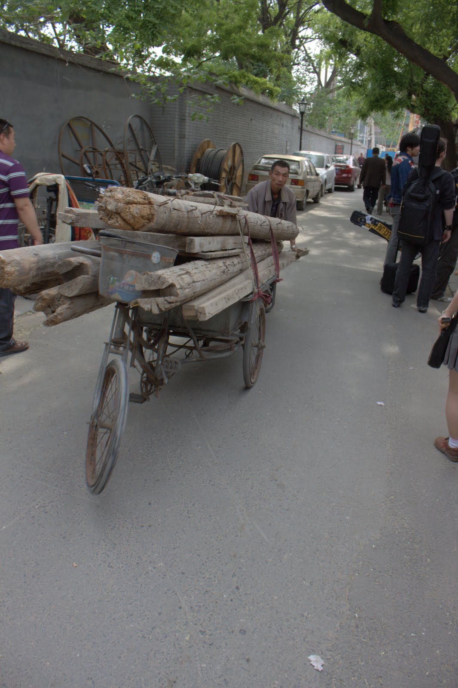 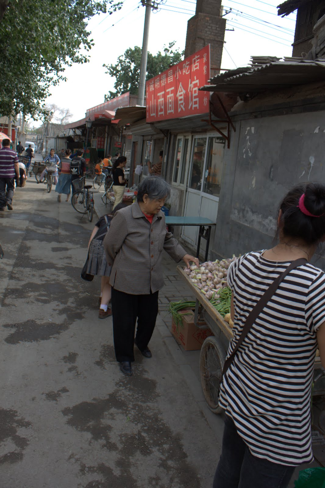\
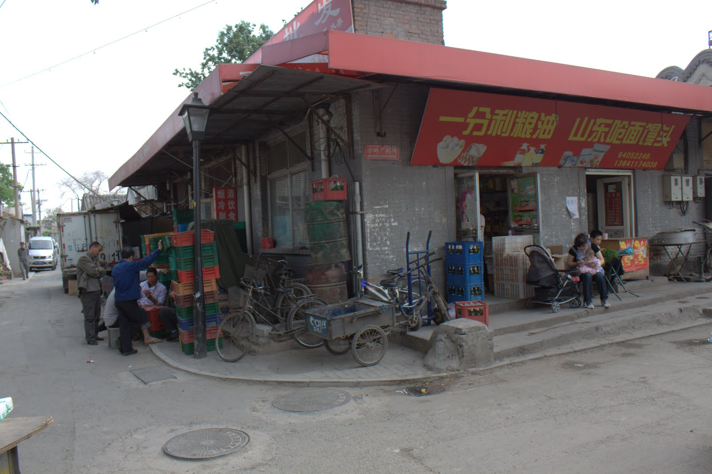

*Drum Tower*: This was built in 1272 and served as the official timepiece of the Chinese government until 1924. If you show up at the right time, you can see an awesome drumming show.

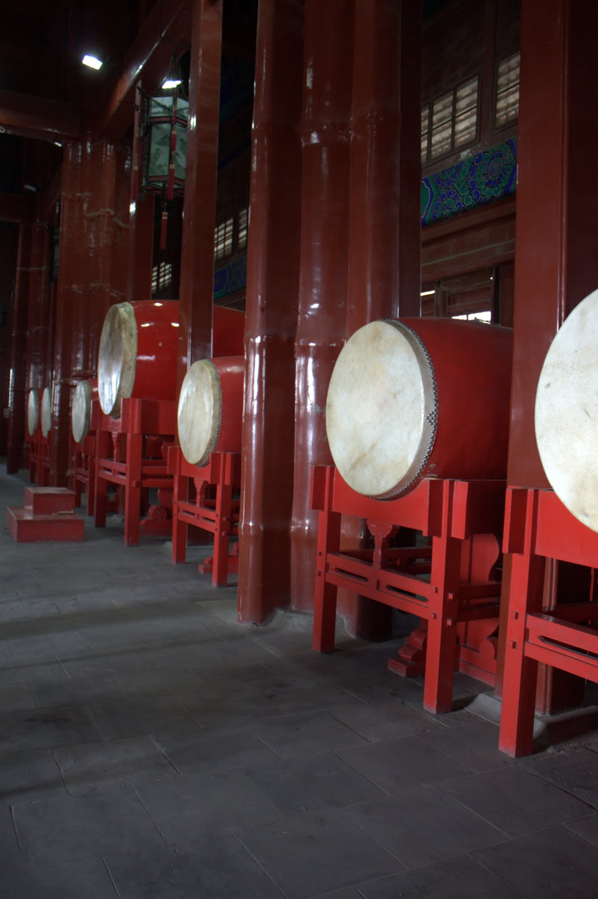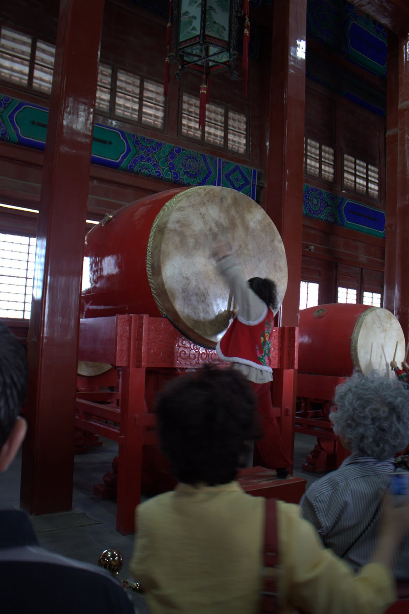

*Great Wall*: We visited the Great Wall at Badaling in 2005, which is apparently the most touristy place to go but also relatively close to Beijing. Go early in the day, to avoid both crowds and heat. Perhaps the best part of visiting at Badaling is that there is a roller coaster that can take you down from the top.

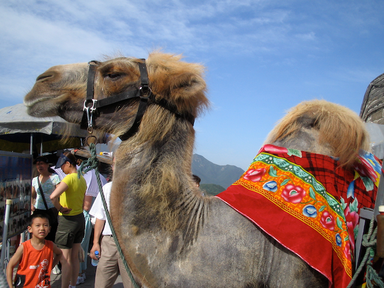\
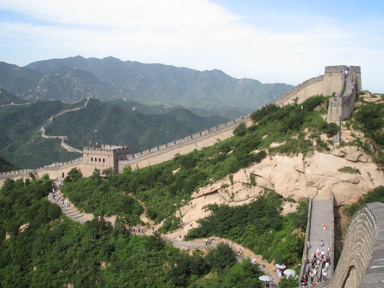\
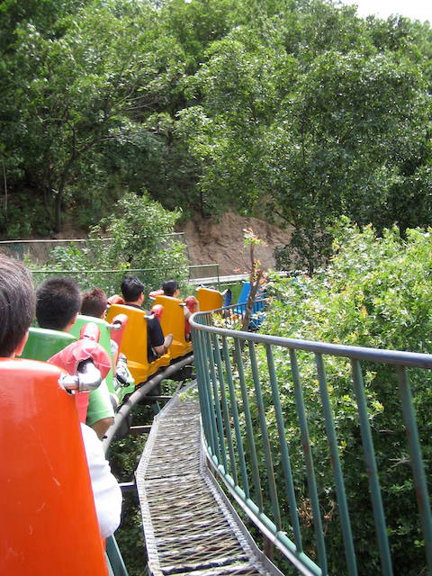

####  

####  

####  

####  

#### Eating

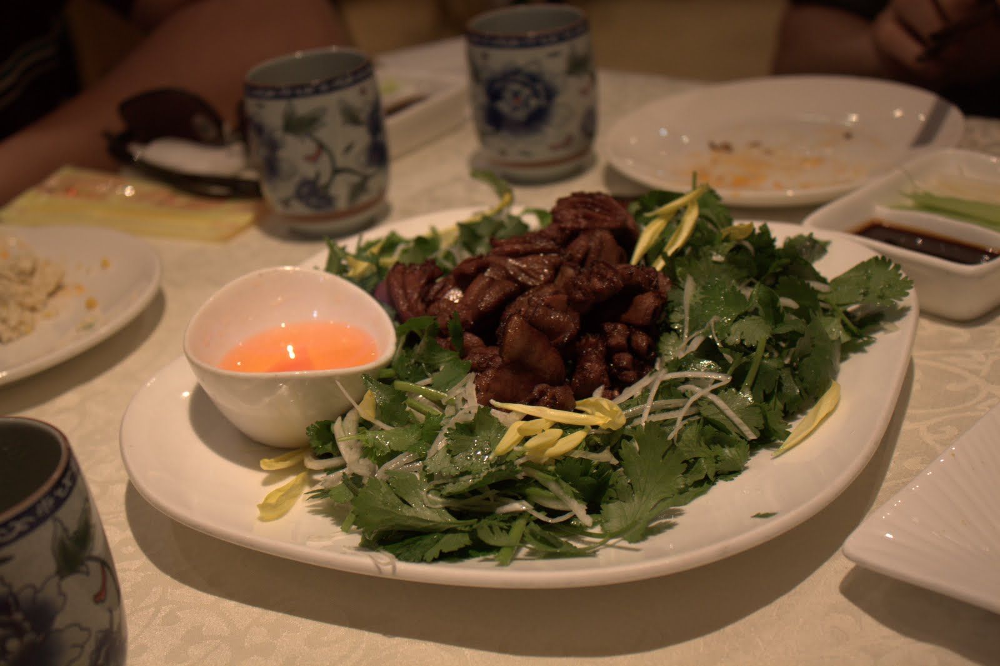

We have had a lot of wonderful meals in Beijing, both as fish-etarians on our first two visits and as omnivores on our most recent visit. Prepare to eat well, but also be prepared to have your sensibilities challenged. A few highlights are:

*Roast duck*: As recently reformed vegetarians, we spent our first two visits to China without trying "Peking Duck" (or, as they call it in Beijing, "roast duck"). On our last visit we had it at Quanjude and it was pretty awesome. We had the full on roast duck experience, including "duck breast" (which is basically just fat and skin) and roasted duck hearts. A must-have. (NB: If you order the duck hearts, they come with a bowl of flaming liquid. Apparently you are not supposed to actually dip the heart into the liquid, as I did.)\
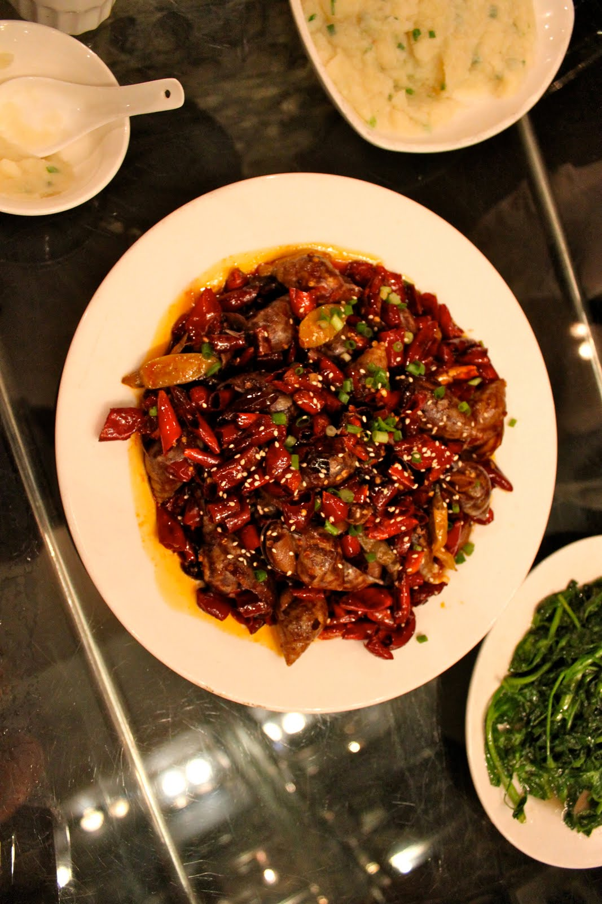

*Sichuan food*: Our friends in China are largely from Sichuan province, and thus we often end up eating at Sichuan restaurants. The Sichuan peppercorn has an amazing numbing quality. Also be sure to try the Sichuan hot pot, which is like a very spicy version of shabu shabu. I would suggest bringing a significant ration of Pepto Bismol, as the western gut starts to ache after a few days of this kind of spicy food. But it is so worth the burn.

*Yunnan food*: One of the most amazing meals we had was at the Rainbow Restaurant in the Beijing Sun Palace Hotel. The greeters are dressed in traditional Yunnan dress, and the food is absolutely amazing with a heavy focus on mushrooms.\
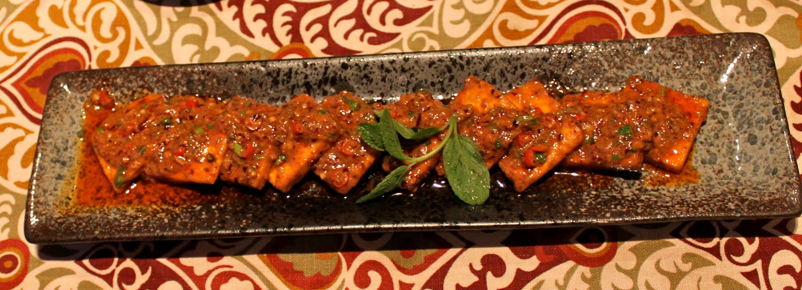

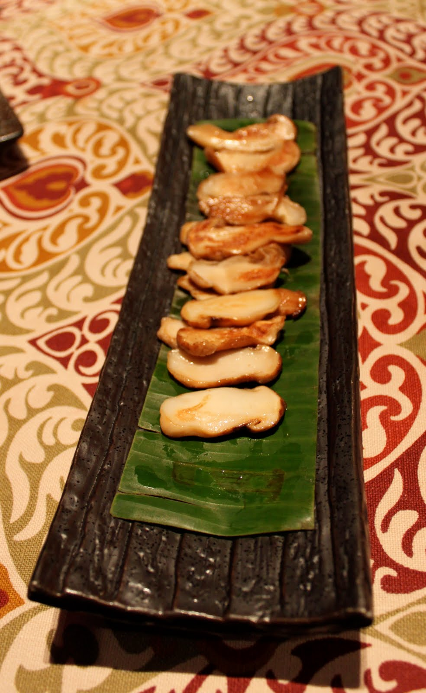

---

## 1 comment captured from the [original post](https://russpoldrack.blogspot.com/2012/04/things-i-like-to-do-in-beijing.html)

**jen o** · 2012-04-25

> I also highly recommend a visit to the Lama Temple (Yonghe Temple) to view the various halls and the 85-foot tall Maitreya buddha--at one time the largest statue of buddha on earth. If you are lucky you can be there during a tibetan prayer service featuring hundreds of monks chanting in a candle-lit and incense-infused hall. truly mesmerizing.
>
> http://en.wikipedia.org/wiki/Yonghe_Temple
